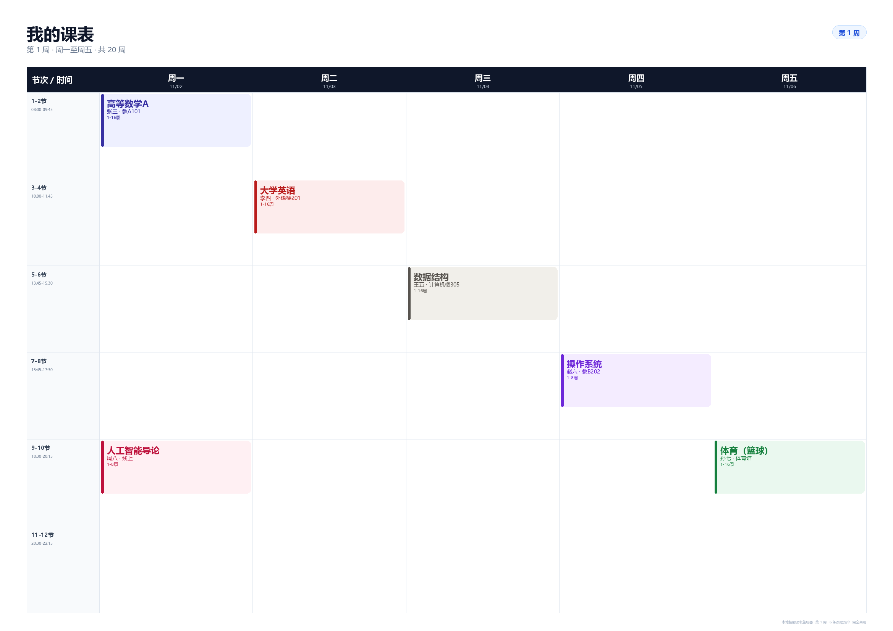

# 📅 智能课表生成器

一个**完全本地运行**的 Streamlit 课表应用：通过结构化表单逐项填写课程名称、教师、教室、星期、节次、周次等信息，校对后生成周课表，并导出为 Excel、PNG、PDF、ICS 日历或打印网页。

> **当前版本 v1.2**：首页封面 → 选择时间模式 → 结构化录入。页面仅开放“结构化文本录入”；Word / PDF / Excel / CSV / Markdown / 图片上传入口暂时隐藏（相关解析代码保留，后续可重新开启）。
>
> 不调用任何外部 API，不需要 DeepSeek / OpenAI API Key，不上传课程内容；渲染与模板计算全部在本机完成。



---

## ✨ 功能一览

### 启动流程

1. 打开应用先看到**首页封面**，点击“开始课表编辑 →”；
2. 进入**选择模式**页：
   - **模式一 · 默认时间**：使用内置 6 时段 / 12 节时间，直接进入录入课程；
   - **模式二 · 自定义时间**：先进入模板设置，设置总周数、上课日、每天节数、时间格，保存后自动进入录入课程；
3. 之后仍可通过左侧导航栏在首页、开始、录入、校对、课表、导出、模板设置、帮助之间自由切换。

### 输入（当前 UI）

- **结构化录入**：课程名称、教师、教室、星期、节次、周次、学分、班级、备注分成独立输入框；
- 每个框只负责一类信息，避免自由文本因写法不同被误识别；
- 除“课程名称”外，其他字段都可以留空；缺少星期/节次的课程进入“待安排”；
- **常用备选库**：点击课程名、教学楼、节次、周次、整段时间即可快速填入，填入后仍可继续编辑；
- 同一门课多个节次（如 `5/6节,9/11节`）会生成多条课程安排。

### 代码保留、入口暂时关闭

以下能力仍保留在 `timetable/extractors.py`、`timetable/ocr.py` 和旧版导入函数中，但当前页面不显示入口：

- `.txt` / `.text` 自由文本；
- `.docx` 段落与表格（含合并单元格）；
- `.pdf` 文字层/表格 + 扫描页本地 OCR；
- `.xlsx` / `.csv` 课程列表与星期×节次网格；
- `.md` / `.markdown` 竖线表格；
- `.png` / `.jpg` / `.webp` / `.bmp` / `.tif` 本地中文 OCR。

### 常用备选库

| 类型 | 备选内容 |
| --- | --- |
| 课程名 | 高等数学、线性代数、概率论与数理统计、大学英语、大学物理、数据结构、操作系统、计算机网络、自动控制原理、数值分析、人工智能导论、思政类课程、体育等 |
| 教学楼 | **正心楼、致知楼、诚意楼、格物楼、电机楼、理学楼** |
| 节次 | 1-2 节、3-4 节、5-6 节、7-8 节、9-10 节、11-12 节、5/6 节、9/10 节、9/11 节 |
| 周次 | 1-16 周、1-8 周、9-16 周、1-8,10-16 周、单周、双周、全周 |
| 整段时间 | 周一至周五的常见“星期 + 节次”组合 |

点击教学楼时会保留你已输入的教室号：例如输入 `正心楼415` 后点击 `诚意楼`，会变成 `诚意楼415`，再手动补全即可。

### 解析（代码能力，当前 UI 主要使用字段解析）

- 时间写法：`第1-2节`、`1-2节`、`第3节`、`1、2节`、`5/6节`、`9/11节`、`0102`、`08:00-09:45`；
- 周次写法：`1-16周`、`1-8,10-16周`、`第1-16周`、`单周`、`双周`、`1-16周(单)`；
- 课程列表表格、星期×节次网格、合并单元格等能力仍保留，供后续重新开放文件入口使用。

### 课表

- 按周查看，支持“全部周次”和单周过滤；
- 自动识别时间冲突并标红；
- 课程颜色按课程名自动分配；
- 支持标准模板（12 节 / 6 时段）和自定义模板（总周数、上课日、每天节数、每格节数、起止时间）；
- 对 `9-11节` 这类非常规端点：网页课表和 PNG/PDF 会按 **1.5 个时间格**（占 11-12 格的一半）显示；Excel 受行高限制仍按合并格显示；
- 标准模板默认时间：

| 时段 | 时间 |
| --- | --- |
| 1-2 节 | 08:00–09:45 |
| 3-4 节 | 10:00–11:45 |
| 5-6 节 | 13:45–15:30 |
| 7-8 节 | 15:45–17:30 |
| 9-10 节 | 18:30–20:15 |
| 11-12 节 | 20:30–22:15 |

### 导出

- **Excel**：合并单元格的周课表 + 课程清单 + 冲突/待安排；
- **PNG**：A4 横向 200 DPI；
- **PDF**：A4 横向，适合打印；
- **ICS**：标准日历文件，可按周导入手机/电脑日历；
- **打印 HTML**：独立网页，浏览器打开后 `Ctrl+P` 打印或另存为 PDF。

### 其他

- 会话内保存（刷新页面/关闭进程后清空）；
- 可下载课程 JSON 留档；
- 所有数据只在本机内存中处理；
- 当前页面不提供文件上传；文件解析代码与 30 MB 上传限制保留，供后续重新开启。

---

## 🚀 快速开始

### 方式一：直接使用项目自带依赖（推荐）

项目中的 `vendor/` 已包含本机可用的 `pdfplumber`、`python-docx`、`openpyxl` 和 `rapidocr_onnxruntime`。在 `streamlit_env` 环境中直接运行：

```powershell
cd E:\Code\Web\timetable_app
streamlit run app.py
```

或双击 `run.bat` / 运行 `run.ps1`。

> `app.py` 会自动把 `vendor/` 加入 `sys.path`，无需手动设置。
> `vendor/` 是针对当前 **Windows + Python 3.13** 环境打包的本地依赖；换机器或换系统时，请按“方式二”安装。

### 方式二：在干净环境中安装

当前页面只需要轻量依赖：

```powershell
conda activate streamlit_env
cd E:\Code\Web\timetable_app
pip install -r requirements.txt
streamlit run app.py
```

如果以后要重新开启 Word / PDF / Excel / 图片 OCR 文件解析，再安装完整依赖：

```powershell
pip install -r requirements-full.txt
```

如果使用自己的 Python 环境，请确保 Python ≥ 3.10（本项目在 Python 3.13 上测试通过）。

### 打开页面

浏览器访问终端输出的地址，通常是：

```text
http://localhost:8501
```

`samples/` 目录保留了 `.docx` / `.xlsx` / `.pdf` / `.png` / `.txt` / `.md` 示例文件；当前文件上传入口暂时关闭，这些文件可用于后续重新开启入口后的测试。

---

## ☁️ 部署上线（Streamlit Community Cloud）

推荐使用 Streamlit Community Cloud：

1. 将本项目推送到 GitHub 仓库（`vendor/` 已在 `.gitignore` 中忽略，不会上传 270MB 依赖）；
2. 打开 <https://share.streamlit.io>，用 GitHub 账号登录；
3. 点击 **New app**，选择仓库和分支；
4. Main file path 填 `app.py`；
5. 点击 **Deploy**。

云端会按 `requirements.txt` 安装轻量依赖（Streamlit / pandas / Pillow / openpyxl），不需要 `vendor/`，也不需要任何 API Key。

> 当前页面只使用结构化录入和导出，所以不需要安装 `requirements-full.txt` 里的 PDF/Word/OCR 依赖；如果以后重新开启文件上传，再把它加入云端依赖即可。

部署成功后，Streamlit 会生成一个 `https://<your-app>.streamlit.app` 地址。

---

## 🧭 使用流程

1. **首页**：点击“开始课表编辑 →”；
2. **选择模式**：模式一使用默认时间，模式二先完成自定义模板；
3. **录入课程**：在结构化表单中填写课程名称，按需填写教师、教室、星期、节次、周次等；可用“常用备选库”快速填入；
4. **校对课程**：检查表格，修正星期/节次/周次/教师/教室；处理“问题与冲突”和“待安排”；
5. **课表视图**：选择周次查看，确认冲突和待安排；
6. **模板设置**：随时按学校作息调整总周数、上课日、节次时间；
7. **导出文件**：生成 Excel / PNG / PDF / ICS / 打印 HTML。

### 结构化录入示例

```text
课程名称：高等数学
教师：张三
教室：正心楼415
星期：周一
节次：5/6节
周次：1-16周
```

每个字段都是独立输入框。多个节次可以写成 `5/6节,9/11节`，会生成两条课程安排；不填星期或节次时，课程会进入“待安排”。

### 旧版自由文本/表格格式（代码保留，当前 UI 不显示）

以下格式仍由 `timetable/parsing.py` 和 `timetable/extractors.py` 支持，但当前页面不提供自由文本输入框或文件上传入口，仅供后续重新开启时使用：

```text
高等数学A 张三 周一 第1-2节 1-16周 教A101
大学英语 李四 周二 3-4节 1-8,10-16周 外语楼201
体育 孙七 周五 9-10节 1-16周(单) 体育馆
```

表格列名：`课程名称 | 教师 | 星期 | 节次 | 周次 | 教室 | 学分`。

---

## 🧱 项目结构

```text
timetable_app/
├── app.py                  # Streamlit 入口：导入 / 校对 / 课表 / 导出 / 设置 / 帮助
├── timetable/
│   ├── models.py           # Course / Template / TimeRow / 周次与冲突逻辑
│   ├── parsing.py          # 规则解析：自由文本、课程列表、星期×节次网格、OCR 网格
│   ├── extractors.py       # txt/md/docx/pdf/xlsx/csv/图片 -> 文本 + 表格
│   ├── ocr.py              # RapidOCR 本地 OCR 封装
│   ├── layout.py           # 课程 -> 周课表布局、合并单元格、冲突
│   ├── render_html.py      # 应用内课表 HTML + 独立打印 HTML
│   ├── render_image.py     # PNG / PDF 渲染（Pillow）
│   ├── export_excel.py     # Excel 导出（openpyxl）
│   ├── export_ics.py       # ICS 日历导出
│   ├── exports.py          # 导出格式统一入口
│   ├── samples.py          # 内置示例文本
│   └── suggestions.py      # 课程名/教学楼/节次/周次常用备选库
├── tests/                  # 单元测试
├── samples/                # 可直接上传体验的示例文件
├── assets/demo.png         # README 预览图
├── tools/make_samples.py   # 重新生成 samples/ 与预览图
├── vendor/                 # 本机依赖（可选，见“方式一”）
├── .streamlit/config.toml  # 上传大小与主题
├── requirements.txt        # 当前页面/云端部署的轻量依赖
├── requirements-full.txt   # 重新开启 Word/PDF/OCR 时使用
├── run.bat / run.ps1
└── README.md
```

---

## 🧪 测试

```powershell
cd E:\Code\Web\timetable_app
$env:PYTHONPATH = "$PWD;$PWD\vendor"
python -m unittest discover -s tests -v
```

测试覆盖：

- 首页封面、模式选择、模式二保存后进入录入、页面跳转；
- 结构化录入、常用备选点击填入、教学楼号保留；
- `9-11节` 等非常规端点的 1.5 格几何计算；
- 自由文本 / 多行 / 一行多条 / 单双周 / 周末（解析代码）；
- 课程列表表格、星期×节次网格、合并单元格；
- Markdown / CSV / XLSX / DOCX；
- 图片 OCR 与扫描 PDF OCR；
- HTML / Excel / PNG / PDF / ICS 导出。

---

## 🔒 隐私与离线说明

- 代码中没有任何 `requests` / HTTP API 调用；
- OCR 使用本地 `rapidocr_onnxruntime` 模型，输入图片不出本机；
- PDF 的 OCR 渲染使用本地 `pypdfium2`；
- 所有数据只保存在当前 Streamlit 会话的 `st.session_state` 中；
- 刷新页面或关闭进程后数据会消失，需要留档请下载 Excel 或 JSON。

---

## ⚠️ 已知限制

1. **当前页面仅开放结构化文本录入**：Word / PDF / Excel / 图片入口暂时隐藏，但解析代码与依赖仍保留；
2. **课程名称必填**：其他字段可留空；缺少星期/节次的课程会进入“待安排”；
3. **多天/多时段**：当前一次表单提交对应一门课的一个或多个节次；同一门课的多个星期请分多次添加，或在校对页复制/编辑；
4. **非标准节次端点**：如 `9-11节` 会占用标准模板的 9-10、11-12 两个时间格，课表按整格显示，导出时间会覆盖到 11-12 时段；
5. **会话存储**：当前版本不做数据库持久化；刷新后需重新录入，或使用 JSON 留档；
6. **旧版 `.doc` / `.xls`**：文件入口重新开启后，也需先另存为 `.docx` / `.xlsx`；
7. **OCR/复杂版式**：文件入口重新开启后，扫描件/图片 OCR 和复杂 PDF 表格仍建议人工校对。

---

## 🛠 常见问题

**Q：为什么某门课进了“待安排”？**  
A：缺少星期/节次，或上课日不在当前模板的上课日里。到“校对课程 → 待安排”快速安排。

**Q：为什么有冲突？**  
A：同一星期、节次重叠且周次有交集。课表会用红框和 ⚠ 标出，可在课程列表修改时间/周次。

**Q：为什么现在看不到上传文件的入口？**  
A：当前版本为了优先解决自由文本/文件格式差异导致的识别错误，暂时只开放结构化文本录入；文件解析和 OCR 代码仍保留，后续可重新开启。

**Q：常用备选库在哪里？**  
A：课程名在“常用课程名”折叠区；教学楼在“上课地点”下方；节次、周次和整段时间在“上课时间”下方。点击即可填入，填入后还能直接编辑，例如点击“正心楼”后补全为“正心楼415”。

**Q：可以商用/二次开发吗？**  
A：代码可自由修改；`vendor/` 内第三方依赖遵循各自许可证（Streamlit、pdfplumber、python-docx、openpyxl、Pillow、RapidOCR 等）。

---

## 🧩 设计要点

1. **结构化优先**：当前 UI 让每个字段只承载一类信息，从源头降低自由文本/文件格式差异带来的误识别；
2. **解析与渲染分离**：`Course` 是唯一数据模型，HTML / PNG / PDF / Excel / ICS 都从同一份 `GridLayout` 渲染；
3. **可校对**：任何录入结果都进入可编辑表格，避免“填完就不能改”；
4. **可配置模板**：标准模板是固定预设，自定义模板用同一套 `TimeRow` 模型，渲染/导出无需分支；
5. **本地优先**：文件解析、OCR、渲染均可离线运行，不调用外部 API。

---

*最后更新：2026-11-02 · v1.2.0*
